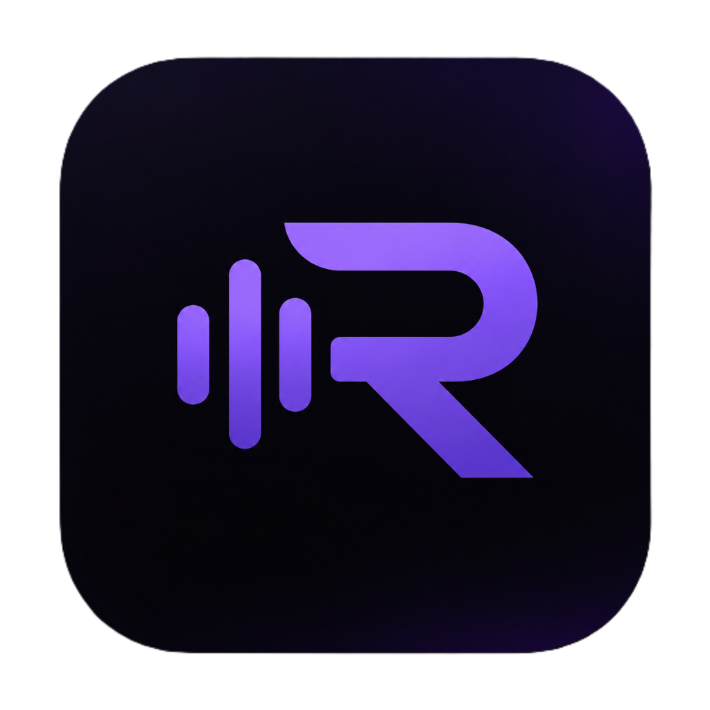

<p align="center">
  
</p>

<h1 align="center">Repert2r</h1>

<p align="center">
  Минималистичное десктоп-приложение для работы с репертуаром: смена тональности и темпа, эквалайзер, разделение трека на вокал и инструментал (минусовки), встроенное пианино и локальное хранилище песен.
</p>

Интерфейс выполнен в тёмной фиолетово-индиговой палитре с карточками, без лишних браузерных элементов и с полной поддержкой работы офлайн.

---

## Основные возможности

### 1. Тон, темп и эквалайзер
- **Изменение тональности:** сдвиг от `-12` до `+12` полутонов в реальном времени с автоматическим определением исходной тональности трека и пересчётом ноты при сдвиге.
- **Управление темпом (BPM):** автоматическое определение BPM трека и плавная регулировка темпа без искажения высоты тона (работает как при прослушивании, так и при сохранении).
- **Скорость прослушивания:** быстрый переключатель `0.25x / 0.5x / 1x / 1.5x / 2x` в нижней панели (только для разбора партий, не влияет на экспортируемый файл).
- **5-полосный эквалайзер:** интерактивная кривая (`60 Hz`, `230 Hz`, `910 Hz`, `3.6 kHz`, `14 kHz`) в диапазоне `±12 дБ` с полупрозрачной звуковой волной в реальном времени на фоне и кнопкой сброса.

### 2. Отделение вокала от музыки (Минусовки)
- **Локальная нейросеть:** разделение любого аудиофайла на две синхронные дорожки — **Вокал** и **Инструментал** — без интернета и сторонних сервисов.
- **Два ползунка громкости (`0–100%`):** настраивайте баланс вокала и инструментала на лету, либо переключайтесь в режим «Только минус» одним нажатием.
- **Чистая память:** разделённые дорожки хранятся только в оперативной памяти во время работы с треком и не засоряют диск временными файлами. При нажатии «Сохранить» микс сводится в итоговый `.mp3` или `.wav` вместе с тональностью, BPM и эквалайзером.

### 3. Встроенное пианино
- **2 октавы (сдвиг `C2–B6`):** игра мышкой (включая плавное глиссандо) и с клавиатуры компьютера на любой раскладке (`Z–M`, `Q–U`, `2–7`).
- **Подсветка тональности трека:** при включённом режиме клавиши, входящие в текущую гамму песни, подсвечиваются для удобной распевки и подбора мелодии.
- **Независимая громкость:** регулируется отдельно от громкости минуса и всегда звучит в чистом строе.

### 4. Логическое хранилище треков
- **Единый список из любых папок:** добавляйте песни кнопкой `+` или перетаскиванием (Drag-and-Drop) — файлы остаются на своих дисках, а в приложении сохраняется их список и порядок.
- **Защита от дубликатов:** проверка содержимого по хэшу `SHA-256` в фоновом потоке с индикатором прогресса при пакетном добавлении.
- **Сортировка, поиск и порядок:** перетаскивание карточек в списке, поиск по названию и сортировка (по алфавиту или дате изменения, по возрастанию/убыванию).
- **Контекстное меню (ПКМ):** *Открыть в папке* (с выделением файла в Проводнике), *Переименовать* в списке, *Свойства* (подробная информация о файле с возможностью копирования) и *Удалить из списка*.
- **Защита несохранённых изменений:** предупреждение при переключении трека, если настройки были изменены, но ещё не экспортированы.

### 5. Экспорт и горячие клавиши
- **Сохранение в `.mp3` и `.wav`:** сначала выбор места сохранения, затем конвертация с прогресс-баром по центру экрана и ссылкой **«Открыть папку»** по завершении.
- **Справка по клавишам (`?`):** `Space` (пауза), `←`/`→` (±5 сек), `↑`/`↓` (±1 полутон), `0` (сброс тональности), `M` (звук), `R` (в начало).

---

## Локальная нейросеть (MDX-Net)

Для создания минусовок используется модель **UVR-MDX-NET-Inst_HQ_3** (~64 МБ в формате `.onnx`), которая уже вшита в дистрибутив — ничего докачивать отдельно не нужно.

- **Ускорение на видеокарте:** вычисления нейросети выполняются на GPU через **DirectML** (работает на видеокартах NVIDIA, AMD и Intel под Windows без установки CUDA).
- **Резервный режим:** если DirectML недоступен, приложение автоматически переключается на обработку силами процессора (CPU).

---

## Установка (для пользователей)

1. Перейдите в раздел [Релизы (Releases)](https://github.com/YNGVLD11/Repert2r/releases/latest).
2. Скачайте установщик **`Repert2r_1.0.0_x64-setup.exe`**.
3. Запустите скачанный файл — установщик сам распакует приложение вместе с моделью нейросети и создаст ярлыки.

---

## Технологический стек

- **Оболочка и бэкенд:** Tauri v2 (Rust)
- **ML-инференс и DSP:** `ort` (ONNX Runtime + DirectML), `rustfft` (STFT / iSTFT)
- **Фронтенд и сборка:** Vanilla JS, HTML5, CSS3, Vite
- **Аудиодвижок:** Web Audio API, `AudioWorklet` (`@soundtouchjs/audio-worklet` с интерполяцией Lanczos), `@breezystack/lamejs` (кодирование MP3), Web Worker (определение тональности и BPM)

---

## Системные требования

- **ОС:** Windows 10 / Windows 11 (64-bit)
- **WebView2:** встроен в Windows 11 и большинство сборок Windows 10 (при необходимости подтягивается установщиком)

---

## Сборка из исходного кода

Требуются установленные **Node.js**, **Rust** (`cargo`) и **Visual Studio Build Tools (C++)**.

1. Клонировать репозиторий:
   ```bash
   git clone https://github.com/YNGVLD11/Repert2r.git
   cd Repert2r
   ```

2. Установить зависимости:
   ```bash
   npm install
   ```

3. Запустить в режиме разработки:
   ```bash
   npm run dev
   ```

4. Собрать релизный `.exe` и установщик:
   ```bash
   npm run dist
   ```
   Готовый установщик появится в `src-tauri/target/release/bundle/nsis/Repert2r_1.0.0_x64-setup.exe`.
